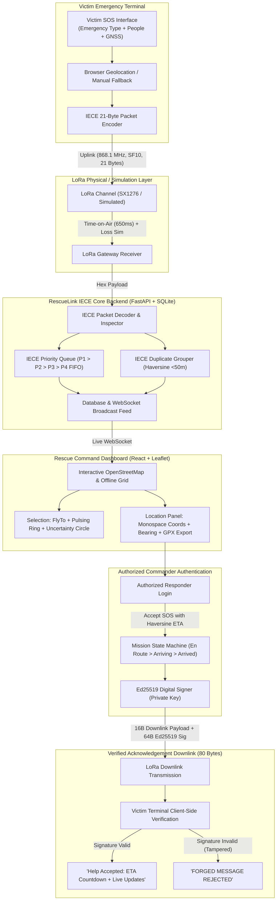

# RESCUE LINK 🛰️🚨
### Offline Emergency Communication & Coordination Prototype
**Hackathon: ASTRA | Domain: Satellite Communication, Navigation and Connectivity**

---

## 📌 Executive Summary & Scenario

During severe natural disasters (floods, cyclones, earthquakes), cellular towers collapse, leaving victims isolated in dark zones. **RESCUE LINK** is an offline emergency communication and coordination engine that enables trapped victims to transmit survival telemetry without cellular networks or internet access.

### 🎬 Scenario Demonstrated Live to Evaluators:
1. **Victim in Flood Basin**: Trapped with zero cellular coverage. The victim initiates an SOS on the terminal.
2. **IECE Binary Packing**: The emergency condition, people count, GNSS coordinates, and fix age are compressed into an exact **21-byte compact struct** (`>B I i i B H B I`).
3. **LoRa Uplink Transmission**: The 21-byte binary packet is transmitted over a low-power LoRa channel (868.1 MHz, CSS SF10 BW125).
4. **IECE Processing Engine**:
   - **Triage Priority Preemption**: Life-threatening conditions (e.g. cardiac arrest P1) preempt the queue ahead of non-critical reports (P3/P4).
   - **Spatial Cluster Grouping**: Reports within a 50-meter radius sharing an emergency condition are auto-grouped into an aggregated cluster card (*"7 people need assistance here"*), preventing dispatch fragmentation.
5. **Rescue Dashboard Map & Location Selection**:
   - Incidents appear in real-time on an interactive Leaflet dashboard with color-coded priority markers and grouped count badges.
   - Clicking an incident in the list or on the map smoothly flies the camera to the victim's location, highlights the marker with a pulsing ring, dims other markers, draws an **accuracy/uncertainty circle** scaling with GPS age, and displays an offline direct vector line from the rescue base station.
6. **Authorized Responder Triage & Acceptance**:
   - An authenticated disaster commander (e.g. *Capt. A. Sharma, NDRF 4th Battalion*) accepts the rescue mission.
   - The commander selects the deployment team type (Boat, Ambulance, Fire/Rescue, Helicopter, Foot patrol).
   - The engine auto-calculates the estimated arrival time (**ETA in minutes**) using the **Haversine formula** based on straight-line distance and team speed.
7. **Compact Signed Downlink Message (16B + 64B Ed25519)**:
   - The backend builds an ultra-compact **16-byte downlink frame** (`>B I B H B H I B`) containing status code, ETA, team type, and instruction note code.
   - An asymmetric digital signature (64 bytes) is appended using the commander's Ed25519 private key (total 80 bytes).
8. **Live Mission Lifecycle Updates to Victim**:
   - The victim terminal independently verifies the Ed25519 signature before displaying: *"Help accepted by Boat Rescue Team (Capt. A. Sharma). Estimated arrival: 12 min."*
   - As the mission advances, the responder sends signed updates through the state machine: **En Route** &rarr; **Arriving Soon (&lt;5 min)** &rarr; **Arrived**.
   - The victim terminal maintains a live countdown timer marked *(estimated)*, sounds gentle Web Audio alert chimes, triggers haptic vibrations, and displays commander instruction notes.
   - If an acknowledgement is forged or tampered with, the terminal actively rejects it and remains in **Pending** status.

---

## 🏛️ System Architecture



---

## ⚖️ Honesty Disclosure: What is Real vs. Simulated

In compliance with the hackathon rules and honest engineering practices:

| Subsystem | Demo Status | Technical Implementation Details |
|---|---|---|
| **IECE 21-Byte Uplink Packet** | **100% REAL** | Exact binary `struct` (`>B I i i B H B I`), microdegree coordinates, bitwise nibble packing for emergency type and severity. Zero JSON overhead over the air. |
| **IECE 16-Byte Downlink Packet** | **100% REAL** | Compact binary `struct` (`>B I B H B H I B`) with status codes, team types, ETA minutes, and instruction note codes. |
| **Ed25519 Cryptographic Signatures** | **100% REAL** | Asymmetric Ed25519 keypairs. Responders sign with private keys; browser client independently verifies using `@noble/ed25519` and Web Crypto API. |
| **Haversine Distance & ETA Engine** | **100% REAL** | Great Circle distance calculation against rescue base station with deployment speeds (Boat 20 km/h, Ambulance 40 km/h, Fire 35 km/h, Heli 150 km/h, Foot 5 km/h). |
| **Map Selection & Uncertainty Circle** | **100% REAL** | Smooth `flyTo`, pulsing highlight ring, 40% background dimming, dynamic accuracy circle scaling with GPS age, compass bearing calculation, and GPX/KML waypoint generation. |
| **LoRa Physical Channel** | **SOFTWARE SIMULATED** | Includes realistic Time-on-Air (650ms), adjustable packet loss (0-80%), jitter, and synthetic RSSI/SNR metrics. *(Labeled with **SIMULATED LINK** badge)*. |
| **Physical Hardware Gateway** | **SUPPORTED** | Optional ESP32 + Semtech SX1276 firmware (C++) and Python USB serial bridge are included in `firmware/`. |
| **Direct Satellite Link** | **ROADMAP / FUTURE** | HANDHELD DIRECT SATELLITE COMMS IS NOT YET IMPLEMENTED. Handheld nodes communicate over terrestrial LoRa to gateways. Gateway satellite backhaul (Astrocast/Iridium/NavIC) is modeled for future isolated mesh deployments. |

---

## 📦 Packet Binary Layouts

### Uplink Packet (21 Bytes)
Detailed specification in [docs/PACKET_FORMAT.md](file:///c:/Users/dd961/OneDrive/Desktop/RescueLink/docs/PACKET_FORMAT.md).
- Format: `>B I i i B H B I`
- 1B Version/Flags, 4B Victim ID, 4B Latitude (microdegrees), 4B Longitude (microdegrees), 1B Type+Severity, 2B GPS Fix Age, 1B People Count, 4B Timestamp.

### Downlink Acknowledgement & Status Packet (80 Bytes)
Detailed specification in [docs/PACKET_FORMAT.md](file:///c:/Users/dd961/OneDrive/Desktop/RescueLink/docs/PACKET_FORMAT.md).
- Payload (16 Bytes): `>B I B H B H I B`
  - 1B Version/Flags, 4B Victim ID, 1B Status Code, 2B ETA (minutes), 1B Team Type, 2B Responder ID, 4B Timestamp, 1B Instruction Note Code.
- Signature (64 Bytes): Asymmetric Ed25519 signature over Bytes 0–15.

---

## 🚀 Quickstart & Demo Walkthrough

### 1. Requirements
- Python 3.10+
- Node.js 18+

### 2. Run Application
```bash
# Start backend server
.\venv\Scripts\python -m uvicorn main:app --app-dir backend --port 8000 --host 0.0.0.0
```

### 3. Open Web Pages
- 🏠 **Landing Page**: [http://localhost:8000/](http://localhost:8000/)
- 🚨 **Victim SOS Terminal**: [http://localhost:8000/victim](http://localhost:8000/victim)
- 🗺️ **Rescue Dashboard & Map**: [http://localhost:8000/dashboard](http://localhost:8000/dashboard)
- 🧪 **Demo Control Center**: [http://localhost:8000/demo](http://localhost:8000/demo)

---

## 📸 Feature Screenshots & Visual Deliverables

All high-resolution responsive screenshots are available in [docs/design/](file:///c:/Users/dd961/OneDrive/Desktop/RescueLink/docs/design/):

### Rescue Dashboard Selection & Location Vectoring
| Feature View | Screenshot File |
|---|---|
| **Selected SOS Marker & Live Popup** | [dashboard_selected_request_popup.png](file:///c:/Users/dd961/OneDrive/Desktop/RescueLink/docs/design/dashboard_selected_request_popup.png) |
| **Detail Drawer Location & Export Panel** | [dashboard_drawer_location_section.png](file:///c:/Users/dd961/OneDrive/Desktop/RescueLink/docs/design/dashboard_drawer_location_section.png) |
| **Clustered Group View & Sub-Victims** | [dashboard_group_view.png](file:///c:/Users/dd961/OneDrive/Desktop/RescueLink/docs/design/dashboard_group_view.png) |
| **Offline Tactical Grid Canvas Fallback** | [dashboard_offline_fallback.png](file:///c:/Users/dd961/OneDrive/Desktop/RescueLink/docs/design/dashboard_offline_fallback.png) |

### Victim Terminal Mission Lifecycle & Cryptographic Verification
| State | Screenshot File |
|---|---|
| **Accepted by Responder (ETA 12m)** | [victim_status_accepted.png](file:///c:/Users/dd961/OneDrive/Desktop/RescueLink/docs/design/victim_status_accepted.png) |
| **En Route (Live Countdown Timer)** | [victim_status_enroute.png](file:///c:/Users/dd961/OneDrive/Desktop/RescueLink/docs/design/victim_status_enroute.png) |
| **Forged Message Rejected (Tamper Alert)** | [victim_tamper_rejected.png](file:///c:/Users/dd961/OneDrive/Desktop/RescueLink/docs/design/victim_tamper_rejected.png) |

---

## 🧪 Automated Test Verification

Run all test suites locally:
```bash
# Unit tests for downlink encoding, Ed25519 crypto, and state transitions
.\venv\Scripts\python backend/tests/test_downlink_packet.py

# End-to-end integration lifecycle test suite (11/11 checks)
.\venv\Scripts\python backend/tests/test_mission_lifecycle.py
```
