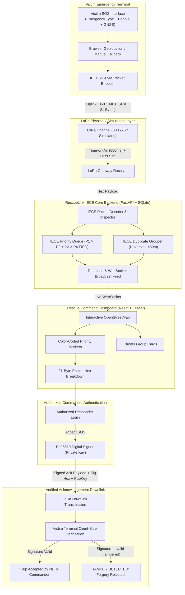

# RESCUE LINK 🛰️🚨
### Offline Emergency Communication & Coordination Prototype
**Hackathon: ASTRA | Domain: Satellite Communication, Navigation and Connectivity**

---

## 📌 Executive Summary & Scenario

During severe natural disasters (floods, cyclones, earthquakes), cellular towers collapse, leaving victims isolated in dark zones. **RESCUE LINK** is an offline emergency communication and coordination engine that enables trapped victims to transmit survival telemetry without cellular networks or internet access.

### 🎬 Scenario Demonstrated Live to Evaluators:
1. **Victim in Flood Basin**: Trapped with zero cellular coverage. The victim initiates an SOS on the terminal.
2. **IECE Binary Packing**: The emergency condition, people count, GNSS coordinates, and fix age are compressed into an exact **21-byte compact struct**.
3. **LoRa Uplink Transmission**: The 21-byte binary packet is transmitted over a low-power LoRa channel (868.1 MHz, CSS SF10 BW125).
4. **IECE Processing Engine**:
   - **Triage Priority Preemption**: Life-threatening conditions (e.g. cardiac arrest P1) preempt the queue ahead of non-critical reports (P3/P4).
   - **Spatial Cluster Grouping**: Reports within a 50-meter radius sharing an emergency condition are auto-grouped into an aggregated cluster card (*"7 people need assistance here"*), preventing dispatch fragmentation.
5. **Rescue Dashboard Map**: Incidents appear in real-time on an interactive OpenStreetMap Leaflet dashboard with color-coded priority markers and grouped count badges.
6. **Authorized Responder Triage**: An authenticated disaster commander (e.g. *Capt. A. Sharma, NDRF 4th Battalion*) accepts the rescue mission.
7. **Ed25519 Signed Acknowledgement**: The backend generates an asymmetric digital signature using the commander's private key and sends it over the LoRa downlink.
8. **Victim Cryptographic Verification**: The victim's terminal verifies the Ed25519 signature against the responder's public key before displaying *"Help accepted by Capt. A. Sharma (NDRF)"*. If an acknowledgement is forged or tampered with, the terminal actively rejects it and remains in **Pending** status.

---

## 🏛️ System Architecture



---

## ⚖️ Honesty Disclosure: What is Real vs. Simulated

In compliance with the hackathon rules and honest engineering practices:

| Subsystem | Demo Status | Technical Implementation Details |
|---|---|---|
| **IECE 21-Byte Binary Packet** | **100% REAL** | Exact binary `struct` (`>B I i i B H B I`), microdegree coordinates, bitwise nibble packing for emergency type and severity. Zero JSON overhead over the air. |
| **IECE Priority Queue** | **100% REAL** | Preemptive heap queue where P1 (cardiac) preempts P3 (stranded) regardless of timestamp arrival order. |
| **IECE Duplicate Grouping** | **100% REAL** | Haversine distance spatial clustering (&lt;50m default) with time window validation. Preserves 100% of individual child records. |
| **Ed25519 Cryptographic Signatures** | **100% REAL** | Asymmetric Ed25519 keypairs. Responders sign with private keys; browser client independently verifies using `@noble/ed25519` and Web Crypto API. |
| **Rescue Map & Dashboard** | **100% REAL** | Live React + Leaflet + OpenStreetMap with custom priority SVG markers and WebSocket real-time feeds. |
| **LoRa Physical Channel** | **SOFTWARE SIMULATED** | Includes realistic Time-on-Air (650ms), adjustable packet loss (0-80%), jitter, and synthetic RSSI/SNR metrics. *(Labeled with **SIMULATED LINK** badge)*. |
| **Physical Hardware Gateway** | **SUPPORTED** | Optional ESP32 + Semtech SX1276 firmware (C++) and Python USB serial bridge are included in `firmware/`. |
| **Direct Satellite Link** | **ROADMAP / FUTURE** | HANDHELD DIRECT SATELLITE COMMS IS NOT YET IMPLEMENTED. Handheld nodes communicate over terrestrial LoRa to gateways. Gateway satellite backhaul (Astrocast/Iridium/NavIC) is modeled for future isolated mesh deployments. |

---

## 📦 IECE Compact 21-Byte Packet Specification

```
0                   1                   2                   3
0 1 2 3 4 5 6 7 8 9 0 1 2 3 4 5 6 7 8 9 0 1 2 3 4 5 6 7 8 9 0 1
+-+-+-+-+-+-+-+-+-+-+-+-+-+-+-+-+-+-+-+-+-+-+-+-+-+-+-+-+-+-+-+-+
| Ver  | Flags  |               Victim Device ID                |
+-+-+-+-+-+-+-+-+-+-+-+-+-+-+-+-+-+-+-+-+-+-+-+-+-+-+-+-+-+-+-+-+
|       Victim Device ID (cont) |          Latitude             |
+-+-+-+-+-+-+-+-+-+-+-+-+-+-+-+-+-+-+-+-+-+-+-+-+-+-+-+-+-+-+-+-+
|     Latitude (microdegrees)   |          Longitude            |
+-+-+-+-+-+-+-+-+-+-+-+-+-+-+-+-+-+-+-+-+-+-+-+-+-+-+-+-+-+-+-+-+
|     Longitude (microdegrees)  | Type | Sev   |  GPS Age (Sec) |
+-+-+-+-+-+-+-+-+-+-+-+-+-+-+-+-+-+-+-+-+-+-+-+-+-+-+-+-+-+-+-+-+
| GPS Age (cont)| People Count  |           Timestamp           |
+-+-+-+-+-+-+-+-+-+-+-+-+-+-+-+-+-+-+-+-+-+-+-+-+-+-+-+-+-+-+-+-+
|                    Timestamp (cont)           |
+-+-+-+-+-+-+-+-+-+-+-+-+-+-+-+-+-+-+-+-+-+-+-+-+
```

| Byte Offset | Size | Field Name | Binary Format | Description |
|---|---|---|---|---|
| `0` | 1 Byte | Version & Flags | `uint8` (`ver:4b, flags:4b`) | Protocol v1. Bit 0: Simulated channel indicator. |
| `1-4` | 4 Bytes | Victim Node ID | `uint32 BE` | Unique 32-bit hardware device ID. |
| `5-8` | 4 Bytes | Latitude | `int32 BE` | Microdegrees (`latitude * 1,000,000`). |
| `9-12` | 4 Bytes | Longitude | `int32 BE` | Microdegrees (`longitude * 1,000,000`). |
| `13` | 1 Byte | Type & Severity | `uint8` (`type:4b, sev:4b`) | High nibble: Emergency type (1-6). Low nibble: Priority (P1-P4). |
| `14-15` | 2 Bytes | GPS Fix Age | `uint16 BE` | Seconds elapsed since last GNSS satellite fix lock. |
| `16` | 1 Byte | People Count | `uint8` | Number of victims requiring extraction (1-255). |
| `17-20` | 4 Bytes | Timestamp | `uint32 BE` | Unix epoch seconds. |
| **TOTAL** | **21 Bytes** | — | — | **Exactly 21 Bytes / 42 Hex Characters** |

---

## 🚀 Quickstart Guide

### Prerequisites
- Python 3.10+
- Node.js v18+ & npm

### 1. Setup & Launch Backend
```bash
# Activate virtual environment
.\venv\Scripts\activate   # (Windows PowerShell)
# or source venv/bin/activate (Linux/macOS)

# Start FastAPI server on port 8000
python -m uvicorn main:app --app-dir backend --port 8000 --host 0.0.0.0
```
*The backend automatically serves the production frontend bundle at `http://localhost:8000` and API docs at `http://localhost:8000/docs`.*

### 2. (Optional) Run Frontend in Hot-Reload Dev Mode
```bash
cd frontend
npm run dev
```
*Opens at `http://localhost:5173` with Vite proxy forwarding `/api` and `/ws` to port 8000.*

---

## 🧪 Verification & Running Unit Tests

To run the complete suite of 19 unit and integration tests:

```bash
# 1. Run IECE algorithmic unit tests (packet, priority queue, cluster grouping, Ed25519 crypto)
.\venv\Scripts\python -m pytest backend/tests -o pythonpath=backend -v

# 2. Run Live End-to-End API Integration Suite (all 11 integration steps)
.\venv\Scripts\python backend/tests/test_live_api.py
```

---

## 🎯 Step-by-Step Scripted Demo for Evaluators

Navigate to `http://localhost:8000` (or click the top navigation bar):

### Step 1: Send a Real Emergency SOS
1. Click **Victim SOS Terminal**.
2. Select **Trapped in Flood (P2 - Urgent Rescue)**.
3. Slide people count to **3**.
4. Click **Use Live Browser GPS** (or leave default coordinates).
5. Click **SEND EMERGENCY SOS NOW**.
6. **Observation**: Notice the stepper transitions from `1. SENT` -> `2. GATEWAY RX` -> `3. PENDING`.
7. Expand the **IECE Compact 21-Byte Packet Inspector** below to show the evaluator the raw 42-character hexadecimal string and the byte-by-byte struct breakdown.

### Step 2: Show IECE Duplicate Grouping
1. Click **Demo Control Panel** -> click **Generate 5 Nearby Flood SOS (Cluster Group)**.
2. Switch to **Rescue Dashboard**.
3. Under the **Cluster Groups** tab, click the newly formed group.
4. **Observation**: Notice the group card reads *"8 people need assistance here (5 reports)"*, showing the centroid marker on the map with a single count badge while preserving all 5 individual victim reports.

### Step 3: Show IECE Priority Preemption (P1 vs P3)
1. Click **Demo Control Panel** -> click **Send Two Sample Emergencies (P1 vs P3)**.
2. Switch to **Rescue Dashboard**.
3. **Observation**: In the **IECE Priority Queue**, observe that the **Heart Attack (P1 - Life Threatening)** appears at the very top of the list, even though the Stranded (P3) emergency was queued first!

### Step 4: Authorized Responder Acceptance & Ed25519 Signing
1. On the **Rescue Dashboard**, click **Responder Login**.
2. Authenticate as **Capt. A. Sharma (NDRF 4th Battalion)**.
3. Click any pending emergency and click **Accept SOS & Sign Acknowledgement**.
4. **Observation**: The status immediately updates to `ACCEPTED`, and an Ed25519 digital signature is generated.

### Step 5: Cryptographic Verification at Victim Terminal
1. Switch back to the **Victim SOS Terminal**.
2. **Observation**: Notice the terminal automatically updates to **HELP ACCEPTED & RESCUE TEAM DISPATCHED** with a green shield badge verifying the responder name, ETA, and public key.

### Step 6: Evaluator Tamper Test
1. Inside the accepted card on the victim terminal, click **Tamper Acknowledgement**.
2. **Observation**: The terminal actively rejects the tampered acknowledgement with **FORGED / TAMPERED ACKNOWLEDGEMENT REJECTED!** and reverts the status to **PENDING**. It proves to the evaluator that the victim terminal will NEVER display a false acceptance without a mathematically valid Ed25519 signature!

---

## 📂 Repository Structure

```
RescueLink/
├── backend/
│   ├── iece/                       # Intelligent Emergency Communication Engine
│   │   ├── packet.py               # Exact 21-byte struct encode/decode & byte explainer
│   │   ├── priority.py             # Preemptive priority queue (P1-P4)
│   │   ├── grouping.py             # Haversine spatial duplicate clustering (<50m)
│   │   └── crypto.py               # Ed25519 keypairs, signing, verification & tampering
│   ├── tests/
│   │   ├── test_packet.py          # Packet size, round-trip, microdegrees tests
│   │   ├── test_priority.py        # Priority sorting & FIFO ties tests
│   │   ├── test_grouping.py        # Haversine & 5-report cluster tests
│   │   ├── test_crypto.py          # Ed25519 sign, verify & tamper detection tests
│   │   ├── test_api.py             # AsyncClient endpoint tests
│   │   └── test_live_api.py        # End-to-end integration test runner
│   ├── models.py                   # SQLAlchemy SQLite models (PostgreSQL compatible)
│   ├── database.py                 # SQLite database connection & session setup
│   ├── simulator.py                # LoRa physical layer delay & packet loss simulator
│   ├── seed.py                     # Realistic disaster seed dataset generator
│   └── main.py                     # FastAPI REST API, WebSockets & static file server
├── frontend/                       # Modular React SPA (ready for Flutter port)
│   ├── src/
│   │   ├── components/
│   │   │   ├── VictimView.jsx      # Mobile-friendly victim beacon & GPS fallback
│   │   │   ├── DashboardView.jsx   # Leaflet map, cluster markers, triage queue & login
│   │   │   ├── DemoControlPanel.jsx# Message journey timeline, channel loss sliders
│   │   │   ├── PacketInspector.jsx # 21-byte visual hex & struct breakdown table
│   │   │   └── AboutHonestyModal.jsx# Honesty disclosure & architecture audit
│   │   ├── utils/
│   │   │   └── crypto.js           # Client-side Ed25519 signature verification
│   │   ├── App.jsx                 # Top-level view router & WebSocket manager
│   │   └── index.css               # Dark theme, emergency orange accents
│   ├── package.json
│   └── vite.config.js
├── firmware/                       # Optional physical ESP32 + LoRa + GNSS implementation
│   ├── esp32_lora_sender/          # ESP32 C++ sender node (PlatformIO)
│   ├── esp32_lora_gateway/         # ESP32 C++ gateway receiver (PlatformIO)
│   ├── serial_bridge.py            # Python serial-to-HTTP gateway bridge
│   └── README.md                   # Pinout wiring & flashing instructions
└── README.md
```

---

## 🏆 Hackathon Alignment (ASTRA: Space, Navigation & Connectivity)

1. **Navigation**: Native GNSS (GPS/NavIC) microdegree positioning with browser geolocation and offline manual fallback coordinates.
2. **Connectivity**: Resilient off-grid communications replacing cellular infrastructure with sub-gigahertz LoRa (868/915 MHz).
3. **Bandwidth Optimization**: 21-byte ultra-compact binary packing allows emergency data to fit in single low-power LoRa chirps with minimum Time-on-Air and battery consumption.
4. **Satellite Gateway Integration**: Ground gateways are architected with serial and IP interfaces to interface with low-Earth orbit (LEO) satellite backhaul transceivers for planetary disaster resilience.
